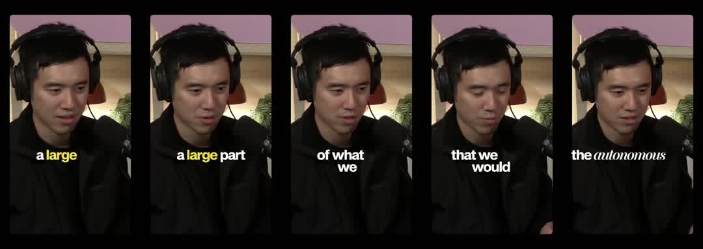

# v08_s16 · full_graphic · 37.0–39.4s (calidad 5)

- **Guion:** In a large part of what we built, we would call it the autonomous
- **Qué se ve:** Clip de entrevista en tarjeta redondeada, sin Kallaway: Stanley con auriculares hablando. Rótulo de cita que se construye: «a large», «part», «of what we built», «that we would call», «the autonomous».
- **Diseño:** Tarjeta vertical de esquinas redondeadas (x≈7–93 %, y≈6–94 %, radio ≈2 % del ancho) sobre negro (sin círculo de cara). Rótulo de cita: sans bold blanca ~44 px con tracking apretado, 1–2 líneas escalonadas (la segunda sangrada), bloque en y≈62–68 % alineado hacia la izquierda; palabra clave en amarillo (#F2E14A aprox.) o en serif itálica blanca; sombra suave; aquí «large» en amarillo y «autonomous» en serif itálica
- **Efectos:** Margen negro; sombra en el texto
- **Animación:** Corte seco; las palabras se añaden una a una y el bloque se reinicia en cada frase
- **Por qué aquí:** Cambia la voz: habla el invitado, así que cambia el sistema de texto (rótulo grande con amarillo/itálica) para que se note que es una cita
