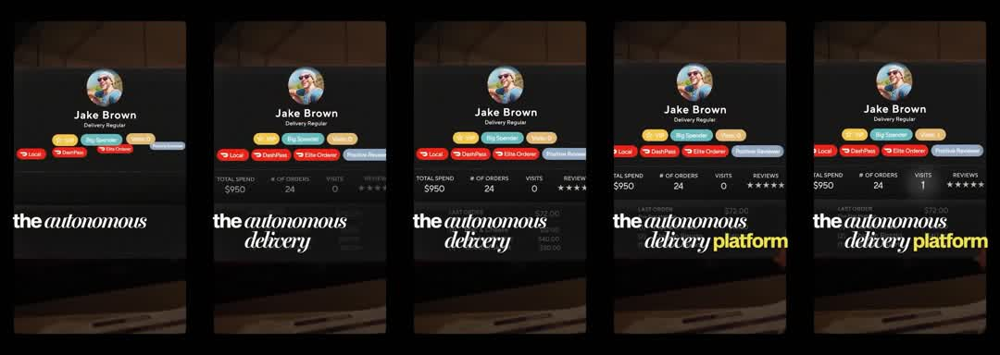

# v08_s17 · full_graphic · 39.4–41.0s (calidad 5)

- **Guion:** delivery platform. Think
- **Qué se ve:** Tarjeta: sobre la cita se inserta una interfaz oscura de perfil de cliente («Jake Brown · Delivery Regular», etiquetas VIP, Local, DashPass, «TOTAL SPEND $950») con el rótulo «the autonomous delivery platform» («platform» en amarillo).
- **Diseño:** Tarjeta vertical de esquinas redondeadas (x≈7–93 %, y≈6–94 %, radio ≈2 % del ancho) sobre negro. Rótulo de cita: sans bold blanca ~44 px con tracking apretado, 1–2 líneas escalonadas (la segunda sangrada), bloque en y≈62–68 % alineado hacia la izquierda; palabra clave en amarillo (#F2E14A aprox.) o en serif itálica blanca; sombra suave: «the» sans, «autonomous delivery» serif itálica, «platform» sans amarilla
- **Efectos:** Interfaz oscura con etiquetas de color (rojo, amarillo, turquesa)
- **Animación:** Corte seco; «delivery» y «platform» se añaden al decirse
- **Por qué aquí:** Nombra el concepto clave → rótulo de 3 estilos (sans/itálica/amarillo) sobre una interfaz que lo ilustra
