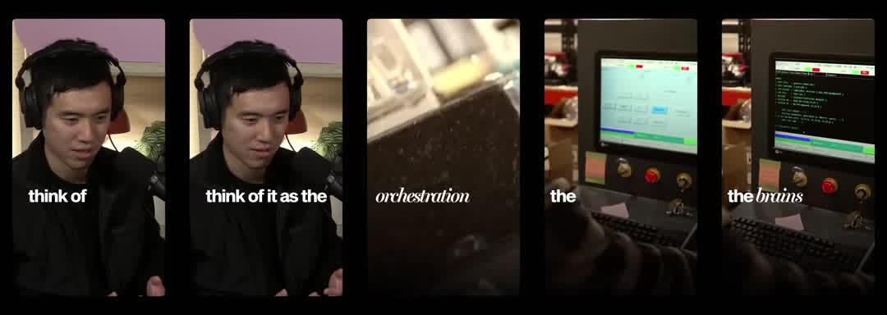

# v08_s18 · full_graphic · 41.0–43.6s (calidad 5)

- **Guion:** of it as the orchestration layer, the brains behind
- **Qué se ve:** Tarjeta: Stanley («think of it as the»), luego insertos de 0,3–0,5 s: placa de circuito roja en macro («orchestration»), placa turquesa con el logo DoorDash («orchestration layer») y puesto de control con código («the brains»).
- **Diseño:** Tarjeta vertical de esquinas redondeadas (x≈7–93 %, y≈6–94 %, radio ≈2 % del ancho) sobre negro. Rótulo de cita: sans bold blanca ~44 px con tracking apretado, 1–2 líneas escalonadas (la segunda sangrada), bloque en y≈62–68 % alineado hacia la izquierda; palabra clave en amarillo (#F2E14A aprox.) o en serif itálica blanca; sombra suave: «orchestration» y «brains» en serif itálica
- **Efectos:** Macro con poca profundidad de campo
- **Animación:** Cortes secos a 41.88, 42.33, 42.58, 42.96 y vuelta a 43.21
- **Por qué aquí:** Metáforas técnicas («orchestration layer», «brains») → hardware literal
