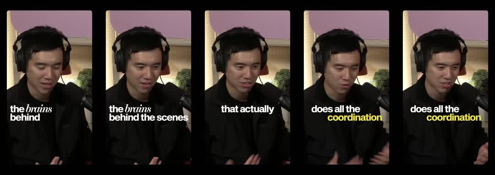

# v08_s19 · full_graphic · 43.6–46.1s (calidad 3)

- **Guion:** the scenes that actually does all the coordination.
- **Qué se ve:** Tarjeta: Stanley; rótulo «the brains / behind the scenes», «that actually», «does all the / coordination» («coordination» en amarillo).
- **Diseño:** Tarjeta vertical de esquinas redondeadas (x≈7–93 %, y≈6–94 %, radio ≈2 % del ancho) sobre negro. Rótulo de cita: sans bold blanca ~44 px con tracking apretado, 1–2 líneas escalonadas (la segunda sangrada), bloque en y≈62–68 % alineado hacia la izquierda; palabra clave en amarillo (#F2E14A aprox.) o en serif itálica blanca; sombra suave
- **Efectos:** Margen negro
- **Animación:** Palabras añadidas una a una; sin cortes de imagen
- **Por qué aquí:** Deja ver al invitado terminar la idea sin insertos
