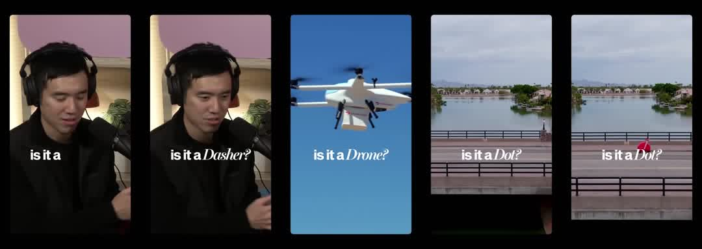

# v08_s20 · full_graphic · 46.1–48.7s (calidad 5)

- **Guion:** Is it a dasher? Is it a drone? Is it a dot? That's
- **Qué se ve:** Tarjeta: «is it a Dasher?» sobre Stanley (46.1–47.21), «is it a Drone?» sobre un dron en cielo azul (47.21–48.05), «is it a Dot?» sobre un robot rojo en un puente (48.05–48.67).
- **Diseño:** Tarjeta vertical de esquinas redondeadas (x≈7–93 %, y≈6–94 %, radio ≈2 % del ancho) sobre negro. Rótulo de cita: sans bold blanca ~44 px con tracking apretado, 1–2 líneas escalonadas (la segunda sangrada), bloque en y≈62–68 % alineado hacia la izquierda; palabra clave en amarillo (#F2E14A aprox.) o en serif itálica blanca; sombra suave: «Dasher?», «Drone?», «Dot?» en serif itálica
- **Efectos:** Margen negro
- **Animación:** Cortes secos exactamente en «drone» y «dot»; el rótulo conserva «is it a» y cambia solo la última palabra
- **Por qué aquí:** Tres preguntas paralelas → misma plantilla de rótulo con una palabra que cambia y una imagen por opción
