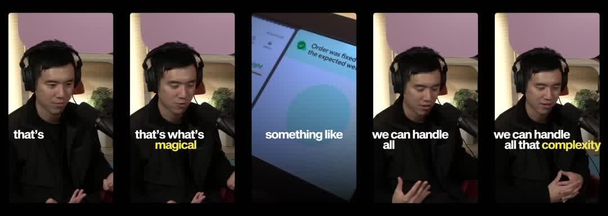

# v08_s21 · full_graphic · 48.7–52.8s (calidad 4)

- **Guion:** what's magical about working with someone like DoorDash. We handle all that complexity.
- **Qué se ve:** Tarjeta: Stanley; rótulos «that's what's / magical» (amarillo), «working with», «something like» + logotipo rojo «DOORDASH» sobre un inserto de una tableta (50.63–51.30), «we can handle / all that complexity» («complexity» en amarillo).
- **Diseño:** Tarjeta vertical de esquinas redondeadas (x≈7–93 %, y≈6–94 %, radio ≈2 % del ancho) sobre negro. Rótulo de cita: sans bold blanca ~44 px con tracking apretado, 1–2 líneas escalonadas (la segunda sangrada), bloque en y≈62–68 % alineado hacia la izquierda; palabra clave en amarillo (#F2E14A aprox.) o en serif itálica blanca; sombra suave; logo «DOORDASH» en rojo (#EB1700 aprox.) con el símbolo
- **Efectos:** Margen negro
- **Animación:** Corte seco al inserto a 50.63 y vuelta a 51.30; el logo aparece a ≈50.95
- **Por qué aquí:** Cierre de la cita con la marca en su color y la palabra «complexity» destacada
