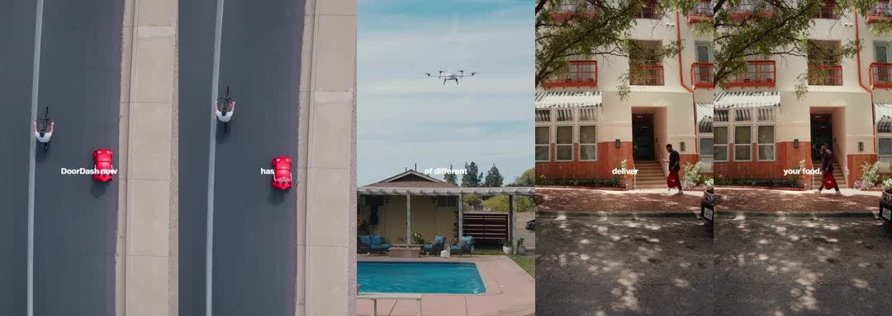

# v08_s24 · full_graphic · 59.9–63.2s (calidad 3)

- **Guion:** Because DoorDash now has lots of different ways to deliver your food.
- **Qué se ve:** B-roll a pantalla completa sin él y sin tarjeta: carretera cenital con un robot rojo y un ciclista (59.85–61.02), dron sobre una casa con piscina (61.02–62.27) y entrada de un edificio con una persona (62.27–63.19). Subtítulos pequeños «Because», «DoorDash now», «has», «lots», «of different», «ways», «your food.».
- **Diseño:** Subtítulo pequeño blanco sans bold, centrado en x e y≈54 %, con pastilla gris semitransparente redondeada cuando el fondo es claro (sin pastilla aquí)
- **Efectos:** Sin tratamiento añadido
- **Animación:** Corte seco de entrada y salida (1 fotograma)
- **Por qué aquí:** «Lots of different ways to deliver» → abre el encuadre a pantalla completa como respiro antes de la lista
