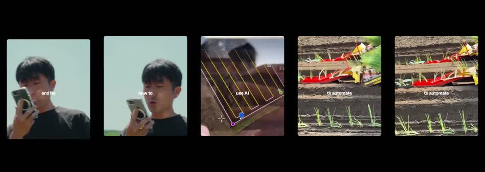

# v09_s02 · full_graphic · 2.6–5.0s (calidad 4)

- **Guion:** he figured out how to use AI to automate his
- **Qué se ve:** Él desaparece: fondo negro y una tarjeta redondeada con b-roll (Hiroki hablando al móvil → app de rutas GPS sobre el campo → plantadora de cerca). Subtítulo pequeño centrado sobre la tarjeta.
- **Diseño:** Pantalla completa sin él: fondo negro (≈#0B0B0B) y el material dentro de una tarjeta vertical de esquinas redondeadas (radio ≈3 % del ancho, ancho ≈86–90 %). Subtítulo: sans geométrica bold blanca, minúsculas con puntuación, ≈30 px de alto de letra sobre 720 px de ancho, centrado en x, 1–3 palabras, centrado sobre la tarjeta en y≈51–54 %.
- **Efectos:** Fondo negro liso; tarjeta con esquinas redondeadas, sin sombra visible ni borde. Sin grano añadido.
- **Animación:** Entra por corte seco; el material dentro de la tarjeta cambia por corte seco. Subtítulo por sustitución instantánea.
- **Por qué aquí:** Describe lo que hizo ('figured out how to use AI to automate') → muestra, no cara. La tarjeta sobre negro separa el relato del gancho.
