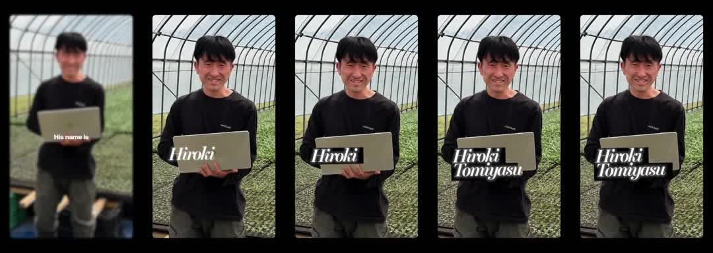

# v09_s04 · full_graphic · 6.2–8.0s (calidad 5)

- **Guion:** His name is Hiroki Tamayasu.
- **Qué se ve:** Tarjeta con foto/clip de Hiroki sonriendo con portátil; entra desenfocada y enfoca; rótulo 'Hiroki' y luego 'Tomiyasu' en serif itálica blanca sobre cajas negras, inclinado sobre el portátil.
- **Diseño:** Pantalla completa sin él: fondo negro, tarjeta vertical redondeada ≈88 % de alto. Nombre en serif itálica de alto contraste blanca, ≈60 px de alto en 720, cada palabra sobre una caja negra rectangular ajustada, dos líneas escalonadas y ligeramente rotadas (≈-5°), en x≈25–60 %, y≈58–70 % (sobre el portátil). Subtítulo pequeño 'His name is' centrado en y≈54 %.
- **Efectos:** Fondo negro liso; tarjeta con esquinas redondeadas, sin sombra visible ni borde. Sin grano añadido.
- **Animación:** Corte seco a la tarjeta desenfocada (blur fuerte) que enfoca en ≈0.4 s; 'Hiroki' aparece con su caja en 6.59 (pop, 1–2 fotogramas) y 'Tomiyasu' en ≈7.2 con la voz. Sale por corte seco.
- **Por qué aquí:** Presentación de personaje: nombre propio = rótulo editorial (serif itálica) en vez de subtítulo; humaniza la historia.
