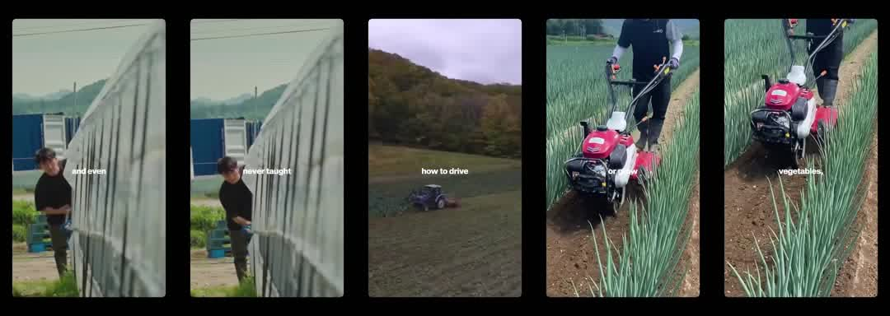

# v09_s05 · full_graphic · 8.0–11.5s (calidad 3)

- **Guion:** And even though he was never taught how to drive tractors or grow vegetables,
- **Qué se ve:** Tarjeta con 3 clips: Hiroki junto al invernadero, tractor arando a lo lejos, motocultor rojo entre cebolletas. Subtítulo centrado sobre la tarjeta.
- **Diseño:** Pantalla completa sin él: fondo negro (≈#0B0B0B) y el material dentro de una tarjeta vertical de esquinas redondeadas (radio ≈3 % del ancho, ancho ≈86–90 %). Subtítulo: sans geométrica bold blanca, minúsculas con puntuación, ≈30 px de alto de letra sobre 720 px de ancho, centrado en x, 1–3 palabras, centrado sobre la tarjeta en y≈51–54 %.
- **Efectos:** Fondo negro liso; tarjeta con esquinas redondeadas, sin sombra visible ni borde. Sin grano añadido.
- **Animación:** Entra por corte seco; el material dentro de la tarjeta cambia por corte seco. Subtítulo por sustitución instantánea.
- **Por qué aquí:** Cada sustantivo ('drive tractors', 'grow vegetables') tiene su plano literal: cuenta el pasado del personaje sin volver a la cara.
