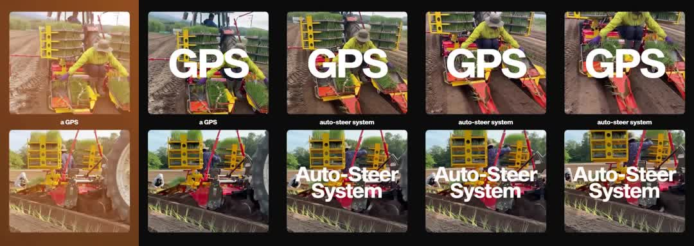

# v09_s12 · full_graphic · 25.8–28.0s (calidad 5)

- **Guion:** GPS auto-steer system that
- **Qué se ve:** Dos tarjetas redondeadas apiladas con clips de la plantadora; destello naranja al entrar; 'GPS' gigante sobre la tarjeta de arriba y 'Auto-Steer System' sobre la de abajo; subtítulo pequeño entre ambas.
- **Diseño:** Pantalla completa sin él: fondo negro, DOS tarjetas redondeadas apiladas (cada una ≈87 % de ancho × 42 % de alto; arriba y≈2–47 %, abajo y≈53–97 %). 'GPS' en sans bold blanca enorme (≈150 px de alto, ≈60 % del ancho) centrada en la tarjeta superior; 'Auto-Steer / System' en sans bold blanca ≈70 px, 2 líneas, centrada en la inferior. Subtítulo pequeño en el hueco entre tarjetas (y≈50 %).
- **Efectos:** Destello de tinte naranja-marrón sobre TODA la composición (incluido el fondo negro) durante ≈3 fotogramas a 15 fps (≈0.2 s) al entrar. Texto grande con sombra/halo suave. Sin grano.
- **Animación:** Corte seco + flash naranja de ≈0.2 s; 'GPS' aparece en 25.9 (con la palabra) y 'Auto-Steer System' en ≈26.5 por pop; los clips siguen en movimiento dentro de las tarjetas. Sale por corte seco.
- **Por qué aquí:** Revelado de la solución: el nombre del invento como titular gigante en dos golpes sincronizados con la voz — momento de máximo valor del vídeo.
