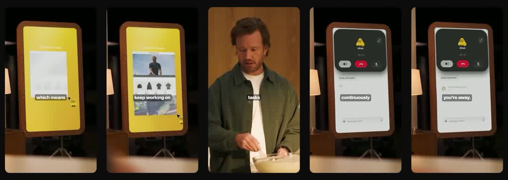

# v10_s10 · full_graphic · 14.7–18.4s (calidad 4)

- **Guion:** which means it can keep working on tasks continuously while you're away.
- **Qué se ve:** Sin él: tarjeta redondeada sobre negro con el dispositivo amarillo de marco de madera mostrando una ventana de navegador, luego un hombre cocinando, luego el dispositivo con una llamada activa.
- **Diseño:** Pantalla completa sin él: fondo negro, tarjeta vertical redondeada ≈90 % de ancho × 92 % de alto. Subtítulo blanco bold con caja gris translúcida redondeada, centrado en y≈54 %.
- **Efectos:** Fondo negro liso; tarjeta con esquinas redondeadas, sin sombra visible ni borde. Sin grano añadido.
- **Animación:** Entra por corte seco; el material dentro de la tarjeta cambia por corte seco. Subtítulo por sustitución instantánea.
- **Por qué aquí:** 'keep working… while you're away': mini-historia (el agente trabaja, el humano cocina) que necesita toda la pantalla.
