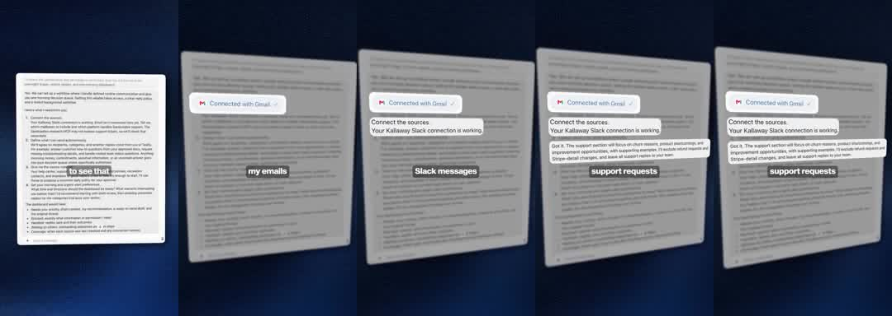

# v10_s38 · full_graphic · 86.1–90.0s (calidad 5)

- **Guion:** want to see that my emails, slack messages, and customer support requests have been
- **Qué se ve:** Sin él: fondo azul oscuro texturizado; la página del chat como tarjeta inclinada en 3D y desenfocada, con 3 fragmentos nítidos que se iluminan uno a uno: 'Connected with Gmail ✓', 'Connect the sources. Your Kallaway Slack connection is working.', 'Got it. The support section will focus on…'.
- **Diseño:** Pantalla completa sin él: fondo azul marino con textura de puntos/ruido fino (≈#0E1E3F); documento blanco-gris en perspectiva 3D (rotación en Y, ≈85 % del ancho), todo desenfocado salvo recortes rectangulares blancos nítidos con esquinas redondeadas y sombra (pastillas de resaltado). Subtítulo bold con caja gris translúcida en y≈54 %.
- **Efectos:** Textura de puntos sutil en el fondo azul; blur fuerte en el documento; pastillas nítidas con sombra suave. Único gráfico claramente 'propio' del vídeo.
- **Animación:** Corte seco; la tarjeta gira/inclina en 3D durante ≈0.6 s y se desenfoca; cada pastilla hace pop con su palabra ('my emails' 86.7, 'Slack messages' 87.7, 'customer support requests' 88.9). Sale por corte seco.
- **Por qué aquí:** Enumeración de 3 fuentes: resalta en el documento real la línea exacta que prueba cada una (emails, Slack, soporte).
