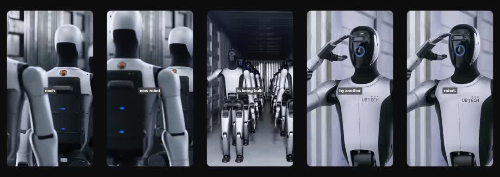

# v12_s03 · full_graphic · 4.7–7.5s (calidad 5)

- **Guion:** new robot is being built by another robot.
- **Qué se ve:** Sin él: tarjeta redondeada sobre negro con 3 clips (espalda de un robot con mochila-batería, robots caminando por un pasillo, robot saludando militarmente con 'UBTECH' en el pecho). Subtítulo en caja: 'each / new robot / is being built / by another / robot.'
- **Diseño:** Pantalla completa sin él: fondo negro, tarjeta vertical redondeada ≈86 % de ancho × 88 % de alto. Subtítulo blanco bold ≈30 px con caja gris translúcida redondeada, centrado en y≈51 %.
- **Efectos:** Fondo negro liso; tarjeta con esquinas redondeadas, sin sombra visible ni borde. Sin grano añadido.
- **Animación:** Entra por corte seco; el material dentro de la tarjeta cambia por corte seco. Subtítulo por sustitución instantánea.
- **Por qué aquí:** La revelación ('built by another robot') merece toda la pantalla: quita su cara 2.8 s y deja 3 planos icónicos.
