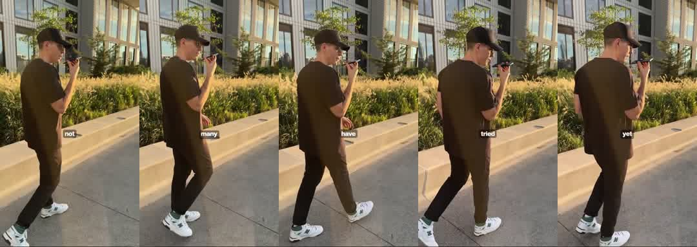

# v13_s04 · full_graphic · 5.6–6.8s (calidad 3)

- **Guion:** Not many people have tried yet
- **Qué se ve:** B-roll propio a pantalla completa: él de espaldas/perfil caminando por un paseo con arbustos, hablándole al móvil a la altura de la boca. Subtítulo pequeño en el centro: «not», «many», «have», «yet».
- **Diseño:** Pantalla completa sin el set. Subtítulo: sans geométrica bold blanca (tipo Inter/Helvetica Now Bold), minúsculas con mayúscula inicial de frase, ~30 px de alto de fuente sobre 720 px de ancho, 1–3 palabras, centrado en x, sombra negra suave. Subtítulo flotando en el centro (y≈45–55 %), encima del material.
- **Efectos:** Grado cálido de atardecer del propio clip; sin overlays.
- **Animación:** Cámara en mano siguiendo al sujeto; subtítulo de 1 palabra por corte. Corte seco.
- **Por qué aquí:** Muestra el uso real (hablarle al teléfono) justo cuando dice que poca gente lo ha probado: demostración física del caso.
