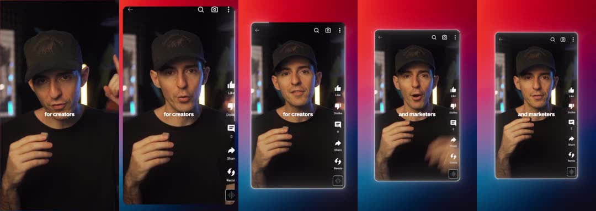

# v13_s06 · full_graphic · 8.2–9.9s (calidad 5)

- **Guion:** creators and marketers.
- **Qué se ve:** El mismo plano de su cara se encoge hasta quedar dentro de un mockup de teléfono con la interfaz de YouTube Shorts (lupa, cámara, ⋮, like, dislike, comentarios, compartir, remix) sobre fondo degradado rojo→azul. Subtítulo pequeño «for creators», «and marketers».
- **Diseño:** Pantalla completa sin el set. Subtítulo: sans geométrica bold blanca (tipo Inter/Helvetica Now Bold), minúsculas con mayúscula inicial de frase, ~30 px de alto de fuente sobre 720 px de ancho, 1–3 palabras, centrado en x, sombra negra suave. Subtítulo flotando en el centro (y≈45–55 %), encima del material.
- **Efectos:** Fondos: degradado rojo→magenta→azul (~#E0202A → #7A2A8A → #1B3FA8) detrás de un mockup de teléfono negro de esquinas redondeadas, o b-roll propio con UI superpuesta.
- **Animación:** Scale-down del A-roll dentro del mockup (0,4 s, suave) + aparición de los íconos de Shorts; después deriva lenta. Sale por corte seco.
- **Por qué aquí:** «para creadores y marketers» → se muestra a sí mismo como un Short: la audiencia se reconoce en el formato.
