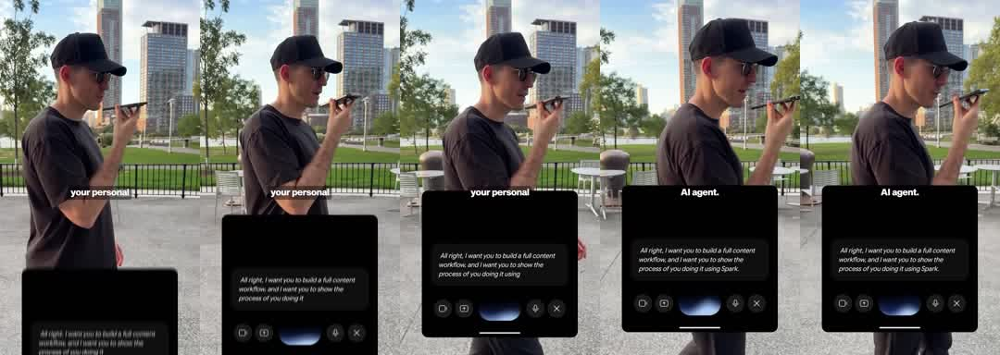

# v13_s08 · full_graphic · 12.5–14.4s (calidad 5)

- **Guion:** your personal AI agent.
- **Qué se ve:** B-roll propio a pantalla completa: él con gafas de sol en un parque urbano con rascacielos, móvil frente a la boca. En el tercio inferior sube un panel negro de Gemini Live (misma transcripción + controles con orbe azul). Subtítulo «your personal», «AI agent.» justo encima del panel.
- **Diseño:** Pantalla completa sin el set. Subtítulo: sans geométrica bold blanca (tipo Inter/Helvetica Now Bold), minúsculas con mayúscula inicial de frase, ~30 px de alto de fuente sobre 720 px de ancho, 1–3 palabras, centrado en x, sombra negra suave. Subtítulo flotando en el centro (y≈45–55 %), encima del material.
- **Efectos:** Fondos: degradado rojo→magenta→azul (~#E0202A → #7A2A8A → #1B3FA8) detrás de un mockup de teléfono negro de esquinas redondeadas, o b-roll propio con UI superpuesta.
- **Animación:** Panel de UI entra con slide-up desde el borde inferior (~0,8 s) y fade-in del texto; b-roll con ligero movimiento de cámara. Corte seco.
- **Por qué aquí:** «tu agente personal de IA»: une persona real + interfaz en un mismo plano; humaniza la función.
