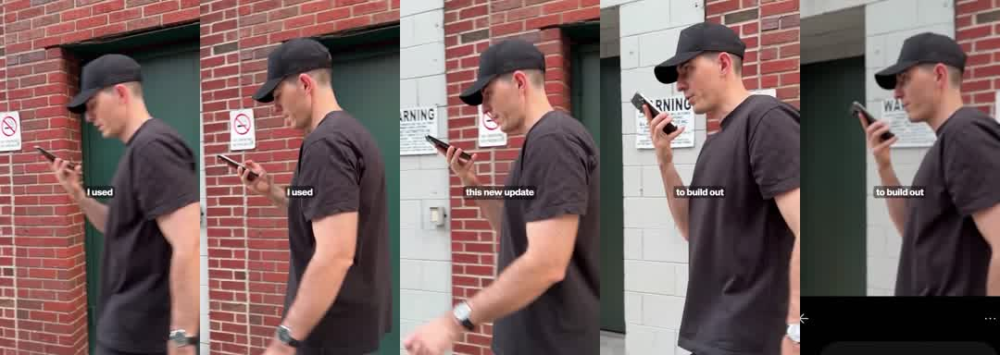

# v13_s14 · full_graphic · 19.1–20.9s (calidad 3)

- **Guion:** I used this new update to build out
- **Qué se ve:** B-roll propio a pantalla completa: él de perfil junto a un muro de ladrillo con cartel «WARNING», mirando el móvil. Subtítulo «I used», «this new update», «to build out».
- **Diseño:** Pantalla completa sin el set. Subtítulo: sans geométrica bold blanca (tipo Inter/Helvetica Now Bold), minúsculas con mayúscula inicial de frase, ~30 px de alto de fuente sobre 720 px de ancho, 1–3 palabras, centrado en x, sombra negra suave. Subtítulo flotando en el centro (y≈45–55 %), encima del material.
- **Efectos:** Grado natural frío del clip.
- **Animación:** Cámara fija/ligera; subtítulos por corte. Sale cuando un panel sube desde abajo.
- **Por qué aquí:** Sitúa la historia: él usando el producto en la calle, no en el estudio.
