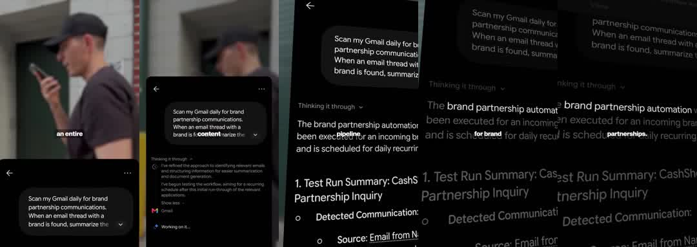

# v13_s15 · full_graphic · 20.9–23.9s (calidad 4)

- **Guion:** an entire content pipeline for brand partnerships.
- **Qué se ve:** El chat de Gemini sube desde abajo y tapa el b-roll (que se desenfoca): prompt «Scan my Gmail daily for brand partnership communications. When an email thread with a brand is found, summarize the…», «Thinking it through», y luego zoom fuerte a «The brand partnership automation workflow has been executed…» y «1. Test Run Summary: CashSheet Partnership Inquiry». Subtítulos «an entire», «content», «pipeline», «for brand», «partnerships.».
- **Diseño:** Pantalla completa sin el set. Subtítulo: sans geométrica bold blanca (tipo Inter/Helvetica Now Bold), minúsculas con mayúscula inicial de frase, ~30 px de alto de fuente sobre 720 px de ancho, 1–3 palabras, centrado en x, sombra negra suave. Subtítulo flotando en el centro (y≈45–55 %), encima del material.
- **Efectos:** Fondos: degradado rojo→magenta→azul (~#E0202A → #7A2A8A → #1B3FA8) detrás de un mockup de teléfono negro de esquinas redondeadas, o b-roll propio con UI superpuesta.
- **Animación:** El mockup entra ya en movimiento: zoom-in lento + inclinación 3D (rotación Y/Z de pocos grados) + scroll del contenido. Corte seco.
- **Por qué aquí:** «construí un pipeline entero» → el resultado real del agente, tan cerca que solo puedes leerlo.
