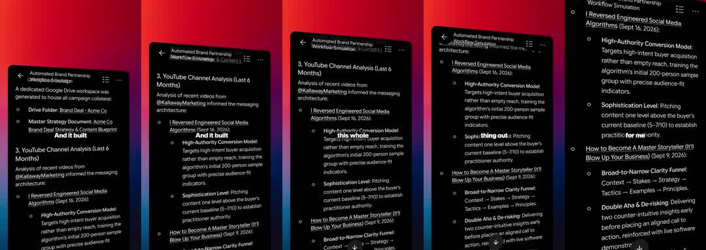

# v13_s18 · full_graphic · 28.5–30.2s (calidad 4)

- **Guion:** it built this whole thing out for me
- **Qué se ve:** Mockup de teléfono sobre degradado rojo→azul mostrando el documento «Automated Brand Partnership Workflow Simulation» (2. Workspace Setup, 3. YouTube Channel Analysis…). Subtítulos «And it built», «this whole», «thing out», «for me».
- **Diseño:** Pantalla completa sin el set. Subtítulo: sans geométrica bold blanca (tipo Inter/Helvetica Now Bold), minúsculas con mayúscula inicial de frase, ~30 px de alto de fuente sobre 720 px de ancho, 1–3 palabras, centrado en x, sombra negra suave. Subtítulo flotando en el centro (y≈45–55 %), encima del material.
- **Efectos:** Fondos: degradado rojo→magenta→azul (~#E0202A → #7A2A8A → #1B3FA8) detrás de un mockup de teléfono negro de esquinas redondeadas, o b-roll propio con UI superpuesta.
- **Animación:** El mockup entra ya en movimiento: zoom-in lento + inclinación 3D (rotación Y/Z de pocos grados) + scroll del contenido. Corte seco.
- **Por qué aquí:** «lo construyó todo» → el entregable completo, mostrado como producto en un móvil.
