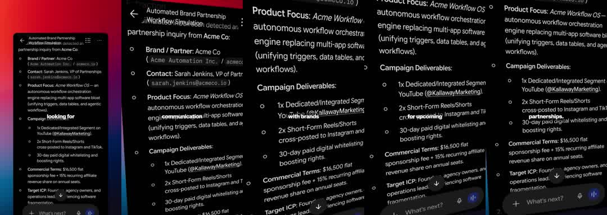

# v13_s21 · full_graphic · 32.7–36.0s (calidad 4)

- **Guion:** looking for any communication with brands for upcoming partnerships.
- **Qué se ve:** Mockup de teléfono sobre degradado (32,74–34,0 s) y luego primer plano inclinado del mismo documento: «Brand / Partner: Acme Co», «Contact: Sarah Jenkins, VP of P…», «Campaign Deliverables», «Commercial Terms: $16,500 flat sponsorship fee…». Subtítulos «looking for», «any», «communication», «with brands», «for upcoming», «partnerships.».
- **Diseño:** Pantalla completa sin el set. Subtítulo: sans geométrica bold blanca (tipo Inter/Helvetica Now Bold), minúsculas con mayúscula inicial de frase, ~30 px de alto de fuente sobre 720 px de ancho, 1–3 palabras, centrado en x, sombra negra suave. Subtítulo flotando en el centro (y≈45–55 %), encima del material.
- **Efectos:** Fondos: degradado rojo→magenta→azul (~#E0202A → #7A2A8A → #1B3FA8) detrás de un mockup de teléfono negro de esquinas redondeadas, o b-roll propio con UI superpuesta.
- **Animación:** El mockup entra ya en movimiento: zoom-in lento + inclinación 3D (rotación Y/Z de pocos grados) + scroll del contenido. Corte seco.
- **Por qué aquí:** Detalle creíble (nombres, cifras) para que el ejemplo parezca real.
