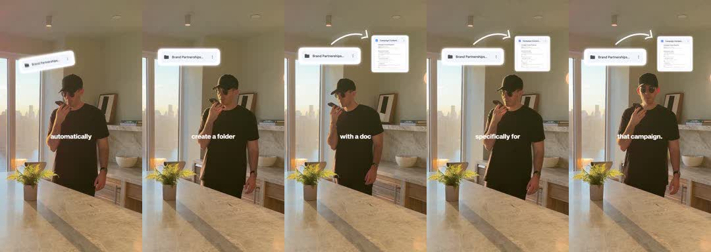

# v13_s25 · full_graphic · 47.9–53.2s (calidad 5)

- **Guion:** automatically create a folder in Google Drive with a doc inside specifically for that campaign
- **Qué se ve:** B-roll propio a pantalla completa: él en una cocina luminosa con encimera de mármol, de pie con el móvil. Sobre el plano flotan una pastilla blanca de carpeta «Brand Partnerships…», una flecha blanca dibujada a mano y una miniatura de documento «Campaign Content…». Subtítulos «automatically», «create a folder», «in Google Drive», «with a doc», «inside», «specifically for», «that campaign.».
- **Diseño:** Pantalla completa sin el set. Subtítulo: sans geométrica bold blanca (tipo Inter/Helvetica Now Bold), minúsculas con mayúscula inicial de frase, ~30 px de alto de fuente sobre 720 px de ancho, 1–3 palabras, centrado en x, sombra negra suave. Subtítulo flotando en el centro (y≈45–55 %), encima del material.
- **Efectos:** Fondos: degradado rojo→magenta→azul (~#E0202A → #7A2A8A → #1B3FA8) detrás de un mockup de teléfono negro de esquinas redondeadas, o b-roll propio con UI superpuesta.
- **Animación:** Carpeta: fly-in con motion blur (~6 fotogramas). Flecha: trazo que se dibuja (~0,9 s). Doc: pop. Todo con seguimiento de cámara. Corte seco de entrada y salida.
- **Por qué aquí:** «crea una carpeta… con un doc dentro» → carpeta → flecha → doc, apareciendo en el orden exacto de las palabras.
