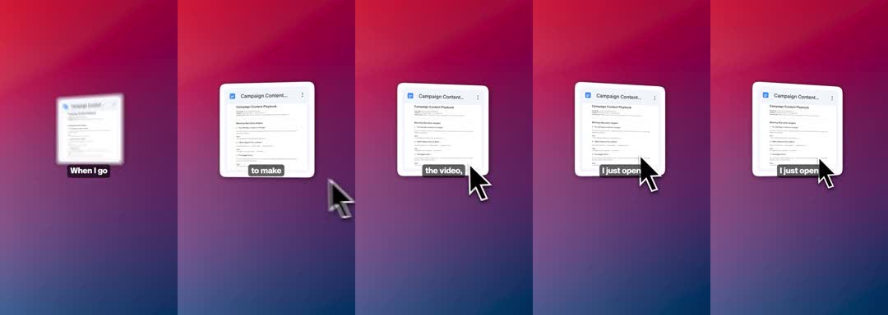

# v13_s27 · full_graphic · 56.5–57.8s (calidad 4)

- **Guion:** When I go to make the video, I just open
- **Qué se ve:** Fondo degradado magenta→azul; una tarjeta de Google Doc «Campaign Content…» aparece en el centro y un cursor negro grande va hacia ella. Subtítulo «When I go», «to make», «the video,», «I just open» en pastilla oscura junto a la tarjeta.
- **Diseño:** Pantalla completa sin el set. Subtítulo: sans geométrica bold blanca (tipo Inter/Helvetica Now Bold), minúsculas con mayúscula inicial de frase, ~30 px de alto de fuente sobre 720 px de ancho, 1–3 palabras, centrado en x, sombra negra suave. Subtítulo flotando en el centro (y≈45–55 %), encima del material.
- **Efectos:** Fondos: degradado rojo→magenta→azul (~#E0202A → #7A2A8A → #1B3FA8) detrás de un mockup de teléfono negro de esquinas redondeadas, o b-roll propio con UI superpuesta.
- **Animación:** El mockup entra ya en movimiento: zoom-in lento + inclinación 3D (rotación Y/Z de pocos grados) + scroll del contenido. Corte seco.
- **Por qué aquí:** «abro ese doc» → la acción de abrirlo, con cursor: guía la mirada como una demo.
