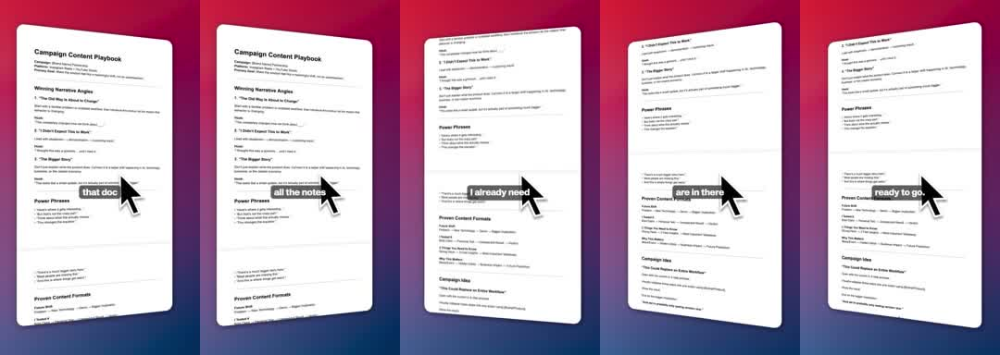

# v13_s28 · full_graphic · 57.8–61.6s (calidad 5)

- **Guion:** that doc and all the notes I already need are in there ready to go.
- **Qué se ve:** La tarjeta se abre a una página completa blanca inclinada en 3D («Campaign Content Playbook»: Winning Narrative Angles, Power Phrases, Proven Content Formats, Campaign Idea) que hace scroll. El subtítulo va en una pastilla gris oscuro pegada al cursor: «that doc», «all the notes», «I already need», «are in there», «ready to go.».
- **Diseño:** Pantalla completa sin el set. Subtítulo: sans geométrica bold blanca (tipo Inter/Helvetica Now Bold), minúsculas con mayúscula inicial de frase, ~30 px de alto de fuente sobre 720 px de ancho, 1–3 palabras, centrado en x, sombra negra suave. Subtítulo flotando en el centro (y≈45–55 %), encima del material.
- **Efectos:** Fondos: degradado rojo→magenta→azul (~#E0202A → #7A2A8A → #1B3FA8) detrás de un mockup de teléfono negro de esquinas redondeadas, o b-roll propio con UI superpuesta.
- **Animación:** El mockup entra ya en movimiento: zoom-in lento + inclinación 3D (rotación Y/Z de pocos grados) + scroll del contenido. Corte seco.
- **Por qué aquí:** El payoff: el documento ya hecho. El subtítulo viaja con el cursor para que leas y mires en el mismo punto.
