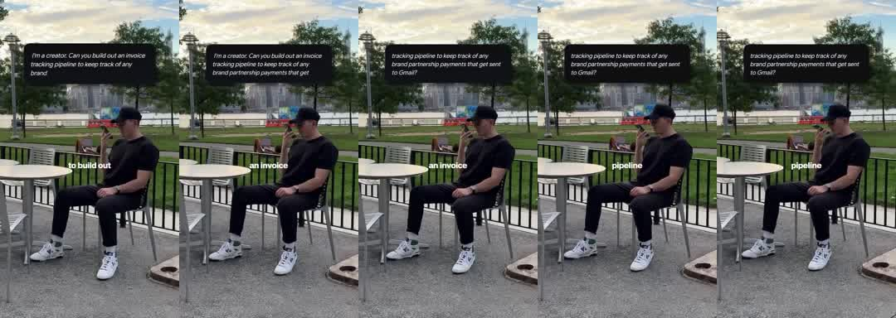

# v13_s37 · full_graphic · 75.4–77.7s (calidad 4)

- **Guion:** build out an invoice tracking pipeline to
- **Qué se ve:** B-roll propio a pantalla completa: él sentado en una terraza con mesas blancas junto al río, móvil en la boca. Arriba una burbuja oscura con su prompt en itálica que se escribe: «I'm a creator. Can you build out an invoice tracking pipeline to keep track of any brand partnership payments that get sent to Gmail?». Subtítulos «to build out», «an invoice», «tracking», «pipeline».
- **Diseño:** Pantalla completa sin el set. Subtítulo: sans geométrica bold blanca (tipo Inter/Helvetica Now Bold), minúsculas con mayúscula inicial de frase, ~30 px de alto de fuente sobre 720 px de ancho, 1–3 palabras, centrado en x, sombra negra suave. Subtítulo flotando en el centro (y≈45–55 %), encima del material.
- **Efectos:** Fondos: degradado rojo→magenta→azul (~#E0202A → #7A2A8A → #1B3FA8) detrás de un mockup de teléfono negro de esquinas redondeadas, o b-roll propio con UI superpuesta.
- **Animación:** Burbuja con fade-in (~3 fotogramas) y texto write-on por palabra; b-roll casi fijo. Corte seco.
- **Por qué aquí:** Lo que dice en off coincide con lo que se escribe en la burbuja: doble canal del mismo mensaje.
