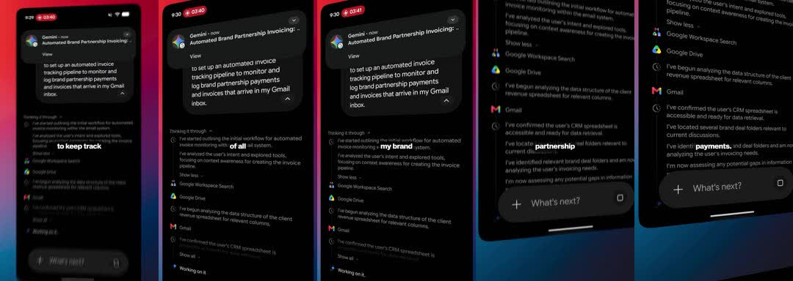

# v13_s38 · full_graphic · 77.7–80.3s (calidad 3)

- **Guion:** keep track of all my brand partnership payments.
- **Qué se ve:** Mockup de teléfono sobre degradado rojo→azul con «Automated Brand Partnership Invoicing» y el log de acciones (Google Workspace Search, Google Drive, Gmail). Subtítulos «to keep track», «of all», «my brand», «partnership», «payments.».
- **Diseño:** Pantalla completa sin el set. Subtítulo: sans geométrica bold blanca (tipo Inter/Helvetica Now Bold), minúsculas con mayúscula inicial de frase, ~30 px de alto de fuente sobre 720 px de ancho, 1–3 palabras, centrado en x, sombra negra suave. Subtítulo flotando en el centro (y≈45–55 %), encima del material.
- **Efectos:** Fondos: degradado rojo→magenta→azul (~#E0202A → #7A2A8A → #1B3FA8) detrás de un mockup de teléfono negro de esquinas redondeadas, o b-roll propio con UI superpuesta.
- **Animación:** El mockup entra ya en movimiento: zoom-in lento + inclinación 3D (rotación Y/Z de pocos grados) + scroll del contenido. Corte seco.
- **Por qué aquí:** Resultado del segundo ejemplo en el mismo lenguaje visual que el primero (consistencia).
