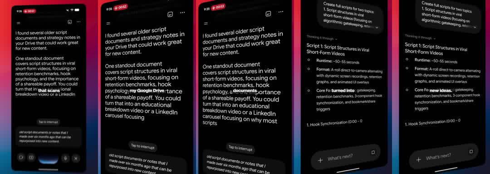

# v13_s40 · full_graphic · 82.3–87.2s (calidad 4)

- **Guion:** scans my Google Drive for old script documents and notes that can be turned into new ideas. And
- **Qué se ve:** Mockup de teléfono sobre degradado con la respuesta de Gemini Live en texto grande: «I found several older script documents and strategy notes in your Drive that could work great for new content…», apareciendo por frases; luego scroll a «Script 1: Script Structures in Viral Short-Form Videos». Subtítulos «that scans», «my Google Drive», «for old script», «documents», «and notes», «that can be», «turned into», «new ideas.».
- **Diseño:** Pantalla completa sin el set. Subtítulo: sans geométrica bold blanca (tipo Inter/Helvetica Now Bold), minúsculas con mayúscula inicial de frase, ~30 px de alto de fuente sobre 720 px de ancho, 1–3 palabras, centrado en x, sombra negra suave. Subtítulo flotando en el centro (y≈45–55 %), encima del material.
- **Efectos:** Fondos: degradado rojo→magenta→azul (~#E0202A → #7A2A8A → #1B3FA8) detrás de un mockup de teléfono negro de esquinas redondeadas, o b-roll propio con UI superpuesta.
- **Animación:** El mockup entra ya en movimiento: zoom-in lento + inclinación 3D (rotación Y/Z de pocos grados) + scroll del contenido. Corte seco.
- **Por qué aquí:** Prueba del tercer ejemplo; el texto en streaming transmite 'está pensando en vivo'.
