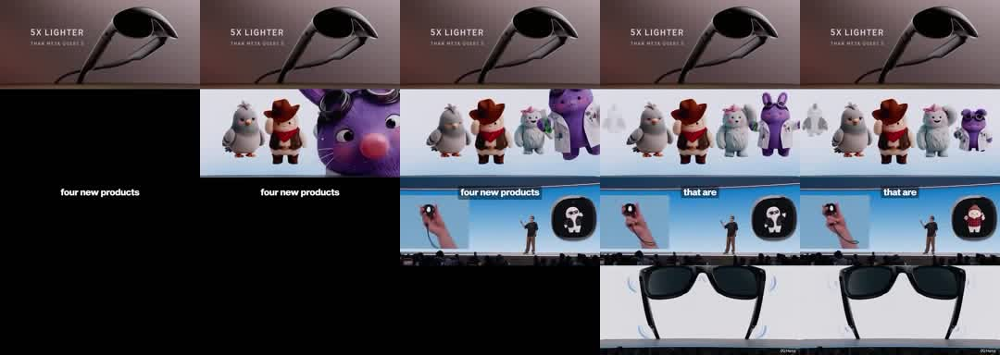

# v14_s04 · full_graphic · 4.4–6.0s (calidad 5)

- **Guion:** four new products that are
- **Qué se ve:** Pantalla completa dividida en 4 franjas horizontales que se van encendiendo de arriba abajo sobre negro: (4,42) gafas-visor «5X LIGHTER than Meta Quest 3»; (4,79) cinco peluches/personajes; (5,12) escenario con dispositivo redondo; (5,58) gafas de sol negras sobre blanco. Subtítulo «four new products», «that are» en el centro con caja oscura.
- **Diseño:** Pantalla completa sin el set. Subtítulo: sans bold blanca (tipo Inter/Helvetica Now Bold) ~30 px de alto de fuente sobre 720 px de ancho, 1–3 palabras, centrado en x, sombra negra suave. Subtítulo en y≈693 px (54 %), con caja oscura semitransparente redondeada detrás cuando el fondo es claro.
- **Efectos:** Material a sangre completa; sin marco.
- **Animación:** Cada franja entra por corte seco (4,42 / 4,79 / 5,12 / 5,58 s) sobre fondo negro; sin slide. Sale todo por corte.
- **Por qué aquí:** «cuatro productos nuevos» → cuatro filas que aparecen una a una: el número se ve construirse.
