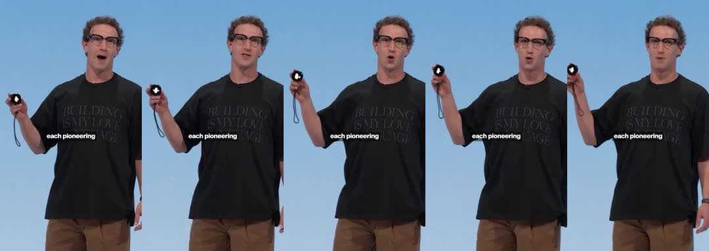

# v14_s05 · full_graphic · 6.0–7.2s (calidad 3)

- **Guion:** each pioneering
- **Qué se ve:** El presentador a pantalla completa sobre azul cielo sosteniendo el dispositivo redondo con cordón; subtítulo «each pioneering».
- **Diseño:** Pantalla completa sin el set. Subtítulo: sans bold blanca (tipo Inter/Helvetica Now Bold) ~30 px de alto de fuente sobre 720 px de ancho, 1–3 palabras, centrado en x, sombra negra suave. Subtítulo en y≈693 px (54 %), con caja oscura semitransparente redondeada detrás cuando el fondo es claro.
- **Efectos:** Material a sangre completa; sin marco.
- **Animación:** Corte seco de entrada y salida.
- **Por qué aquí:** Mantiene el rostro del lanzamiento mientras completa la frase.
