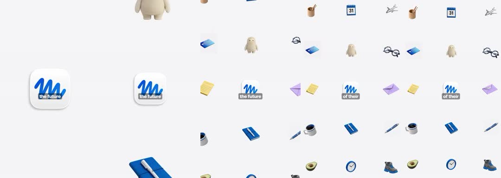

# v14_s06 · full_graphic · 7.2–8.2s (calidad 3)

- **Guion:** the future of their
- **Qué se ve:** Fondo blanco con un ícono de app (garabato azul en cuadrado redondeado) en el centro; la cámara se aleja y aparece una rejilla de objetos 3D (peluche, gafas, libreta, libro, bota). Subtítulo «the future», «of their».
- **Diseño:** Pantalla completa sin el set. Subtítulo: sans bold blanca (tipo Inter/Helvetica Now Bold) ~30 px de alto de fuente sobre 720 px de ancho, 1–3 palabras, centrado en x, sombra negra suave. Subtítulo en y≈693 px (54 %), con caja oscura semitransparente redondeada detrás cuando el fondo es claro.
- **Efectos:** Material a sangre completa; sin marco.
- **Animación:** Corte seco de entrada y salida.
- **Por qué aquí:** «el futuro» → ícono nuevo y limpio; el blanco da un respiro de contraste tras el negro.
