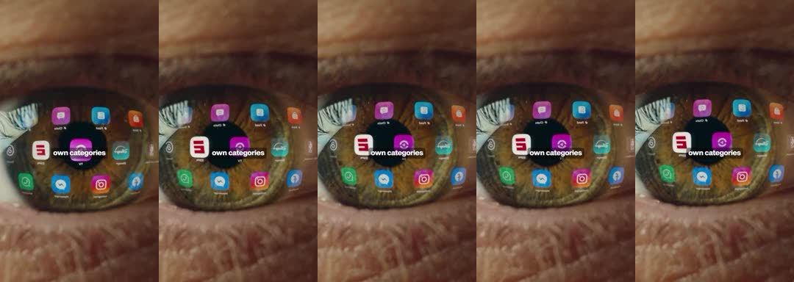

# v14_s07 · full_graphic · 8.2–9.3s (calidad 4)

- **Guion:** own categories.
- **Qué se ve:** Primerísimo plano de un ojo marrón con íconos de apps (Instagram, Messenger, WhatsApp y otros) flotando sobre el iris. Subtítulo «own categories».
- **Diseño:** Pantalla completa sin el set. Subtítulo: sans bold blanca (tipo Inter/Helvetica Now Bold) ~30 px de alto de fuente sobre 720 px de ancho, 1–3 palabras, centrado en x, sombra negra suave. Subtítulo en y≈693 px (54 %), con caja oscura semitransparente redondeada detrás cuando el fondo es claro.
- **Efectos:** Material a sangre completa; sin marco.
- **Animación:** Corte seco de entrada y salida.
- **Por qué aquí:** Imagen fuerte y rara para sostener la atención al final del gancho.
