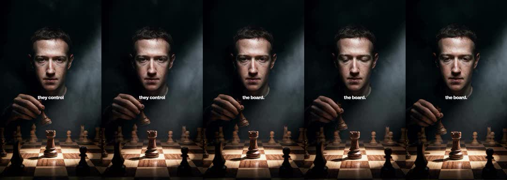

# v14_s70 · full_graphic · 119.2–120.3s (calidad 5)

- **Guion:** control the board.
- **Qué se ve:** Imagen a pantalla completa: el directivo en penumbra moviendo una pieza sobre un tablero de ajedrez iluminado. Subtítulos «they control», «the board.» en el centro.
- **Diseño:** Pantalla completa sin el set. Subtítulo: sans bold blanca (tipo Inter/Helvetica Now Bold) ~30 px de alto de fuente sobre 720 px de ancho, 1–3 palabras, centrado en x, sombra negra suave. Subtítulo en y≈693 px (54 %), con caja oscura semitransparente redondeada detrás cuando el fondo es claro.
- **Efectos:** Material a sangre completa; sin marco.
- **Animación:** Corte seco de entrada y salida.
- **Por qué aquí:** Cierra la metáfora del ajedrez abierta en el s 10,5 (callback visual).
