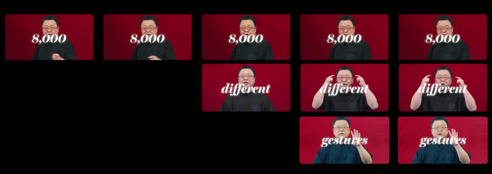

# v15_s26 · full_graphic · 31.8–33.6s (calidad 5)

- **Guion:** ,000 different gestures.
- **Qué se ve:** Fondo negro con 3 mosaicos horizontales redondeados del presentador haciendo gestos distintos, que aparecen uno bajo otro; sobre cada uno una palabra en serif itálica blanca: «8,000», «different», «gestures».
- **Diseño:** Pantalla completa sin el set, fondo negro. Subtítulo: sans bold blanca (tipo Inter/Helvetica Now Bold) ~30 px de alto de fuente sobre 720 px de ancho, 1–3 palabras, centrado en x, sombra negra suave. Subtítulo en y≈693 px (54 %) con caja oscura semitransparente.
- **Efectos:** Fondo negro puro; clips dentro de marcos de esquinas redondeadas (~24 px de radio).
- **Animación:** Corte seco; elementos internos aparecen por corte/pop.
- **Por qué aquí:** «8.000 gestos distintos» → tres ejemplos de gestos, la frase repartida en tres imágenes.
