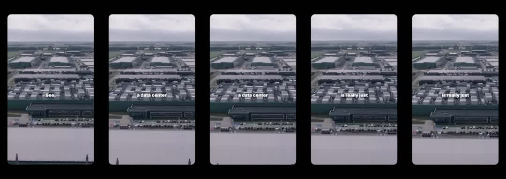

# v16_s05 · full_graphic · 8.7–10.0s (calidad 4)

- **Guion:** See, a data center is really just thousands
- **Qué se ve:** Tarjeta vertical sobre negro con vista aérea de un campus de centros de datos (naves grises). Subtítulos «See,», «a data center», «is really just».
- **Diseño:** Pantalla completa NEGRA con el material dentro de una tarjeta vertical de esquinas redondeadas (~24 px de radio): x≈54–666 px (85 % del ancho), y≈103–1176 px (84 % del alto). Subtítulo: sans bold blanca (tipo Inter/Helvetica Now Bold) ~30 px de alto de fuente sobre 720 px de ancho, 1–3 palabras, centrado en x, sombra negra suave. Subtítulo en y≈680 px (53 %), sobre la tarjeta, con sombra.
- **Efectos:** Fondo negro puro alrededor de la tarjeta; rótulos «NO …» en sans extendida rojo oscuro (~#B01E2E) con sombra/duplicado desplazado.
- **Animación:** La tarjeta entra por corte; dentro, franjas y rótulos aparecen de arriba abajo; sale por corte seco.
- **Por qué aquí:** Cambio de formato (tarjeta sobre negro) = «ahora te explico»: abre el bloque didáctico.
