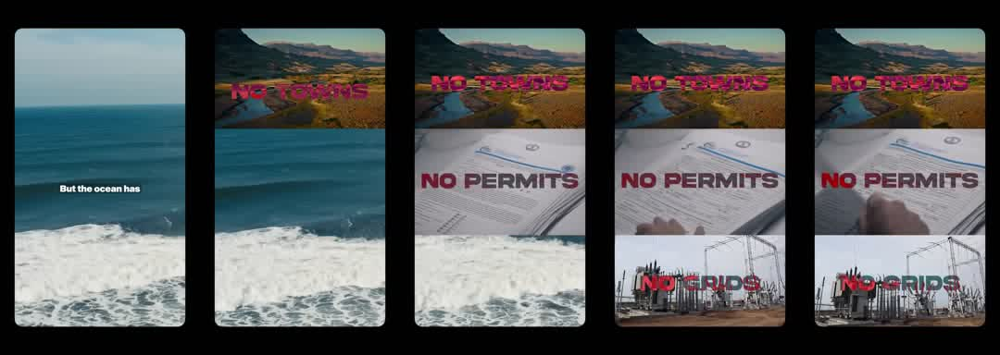

# v16_s15 · full_graphic · 20.6–25.0s (calidad 5)

- **Guion:** But the ocean has no towns, no permits, and no grids to constrain.
- **Qué se ve:** Tarjeta vertical con olas rompiendo; sobre ella aparecen tres franjas horizontales con rótulo rojo: «NO TOWNS» sobre un valle (21,53), «NO PERMITS» sobre un formulario (22,30), «NO GRIDS» sobre una subestación (23,13). Subtítulo «But the ocean has» solo al principio.
- **Diseño:** Pantalla completa NEGRA con el material dentro de una tarjeta vertical de esquinas redondeadas (~24 px de radio): x≈54–666 px (85 % del ancho), y≈103–1176 px (84 % del alto). Subtítulo: sans bold blanca (tipo Inter/Helvetica Now Bold) ~30 px de alto de fuente sobre 720 px de ancho, 1–3 palabras, centrado en x, sombra negra suave. Subtítulo en y≈680 px (53 %), sobre la tarjeta, con sombra.
- **Efectos:** Fondo negro puro alrededor de la tarjeta; rótulos «NO …» en sans extendida rojo oscuro (~#B01E2E) con sombra/duplicado desplazado.
- **Animación:** La tarjeta entra por corte; dentro, franjas y rótulos aparecen de arriba abajo; sale por corte seco.
- **Por qué aquí:** Triple negación («no… no… no…») → tres franjas que se apilan al ritmo de la voz; el subtítulo se apaga para no competir.
