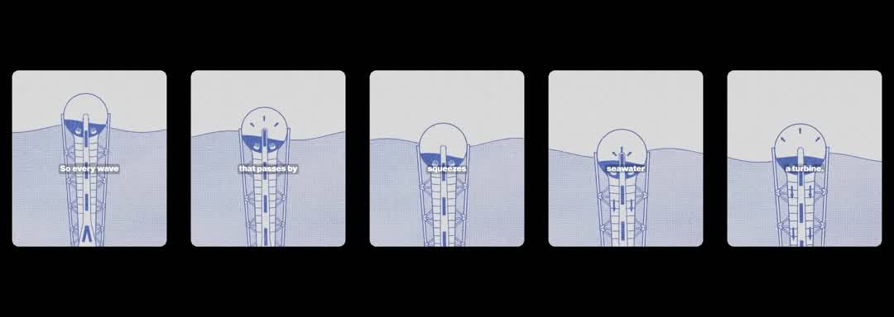

# v16_s26 · full_graphic · 46.7–50.0s (calidad 5)

- **Guion:** Every wave that passes by squeezes seawater through its herbide.
- **Qué se ve:** Tarjeta casi cuadrada sobre negro (x≈47–670, y≈283–994 px) con un diagrama animado en línea azul sobre fondo hueso punteado: corte transversal de la boya; el nivel del agua sube y baja, flechas dentro y aguja de indicador en la cúpula. Subtítulos «So every wave», «that passes by», «squeezes», «seawater», «a turbine.».
- **Diseño:** Pantalla completa NEGRA con el material dentro de una tarjeta vertical de esquinas redondeadas (~24 px de radio): x≈54–666 px (85 % del ancho), y≈103–1176 px (84 % del alto). Subtítulo: sans bold blanca (tipo Inter/Helvetica Now Bold) ~30 px de alto de fuente sobre 720 px de ancho, 1–3 palabras, centrado en x, sombra negra suave. Subtítulo en y≈680 px (53 %), sobre la tarjeta, con sombra.
- **Efectos:** Fondo negro puro alrededor de la tarjeta; rótulos «NO …» en sans extendida rojo oscuro (~#B01E2E) con sombra/duplicado desplazado.
- **Animación:** La tarjeta entra por corte; dentro, franjas y rótulos aparecen de arriba abajo; sale por corte seco.
- **Por qué aquí:** Mecanismo → diagrama: el momento de valor del video se visualiza con un esquema, no con metraje.
