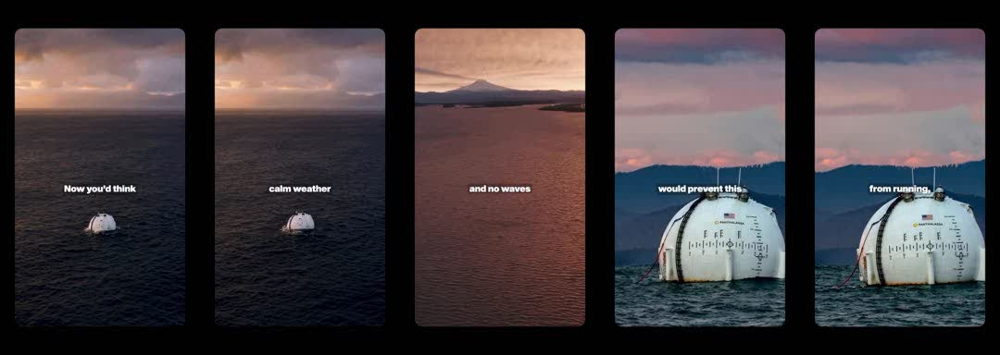

# v16_s36 · full_graphic · 60.3–64.3s (calidad 4)

- **Guion:** That you didn't calm weather and no waves in the ocean would prevent this from running.
- **Qué se ve:** Tarjeta vertical con 3 clips: boya pequeña en mar oscuro al atardecer (60,33), mar rojizo en calma con montaña (61,83), boya de cerca con cielo rosa (63,10). Subtítulos «Now you'd think», «calm weather», «and no waves», «in the ocean», «would prevent this», «from running.».
- **Diseño:** Pantalla completa NEGRA con el material dentro de una tarjeta vertical de esquinas redondeadas (~24 px de radio): x≈54–666 px (85 % del ancho), y≈103–1176 px (84 % del alto). Subtítulo: sans bold blanca (tipo Inter/Helvetica Now Bold) ~30 px de alto de fuente sobre 720 px de ancho, 1–3 palabras, centrado en x, sombra negra suave. Subtítulo en y≈680 px (53 %), sobre la tarjeta, con sombra.
- **Efectos:** Fondo negro puro alrededor de la tarjeta; rótulos «NO …» en sans extendida rojo oscuro (~#B01E2E) con sombra/duplicado desplazado.
- **Animación:** La tarjeta entra por corte; dentro, franjas y rótulos aparecen de arriba abajo; sale por corte seco.
- **Por qué aquí:** Objeción («¿y si no hay olas?») → mar en calma; el formato tarjeta marca otra pregunta didáctica.
