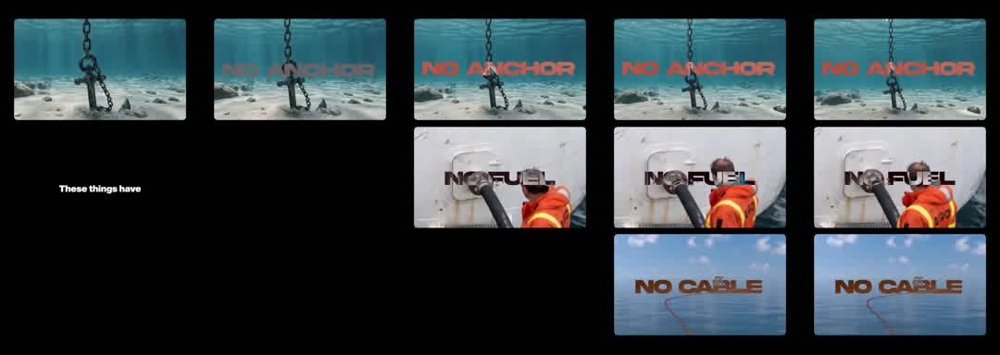

# v16_s44 · full_graphic · 79.9–83.5s (calidad 5)

- **Guion:** These things have no anchor, no fuel, and no cable to shore.
- **Qué se ve:** Pantalla negra con tres franjas horizontales redondeadas que aparecen de arriba abajo: ancla en fondo marino con «NO ANCHOR» (79,93; rótulo ~80,5), operario junto a una toma de combustible con «NO FUEL» (81,20), mar en calma con una línea roja y «NO CABLE» (81,97). Subtítulo «These things have» solo al inicio, en el hueco negro.
- **Diseño:** Pantalla completa NEGRA con el material dentro de una tarjeta vertical de esquinas redondeadas (~24 px de radio): x≈54–666 px (85 % del ancho), y≈103–1176 px (84 % del alto). Subtítulo: sans bold blanca (tipo Inter/Helvetica Now Bold) ~30 px de alto de fuente sobre 720 px de ancho, 1–3 palabras, centrado en x, sombra negra suave. Subtítulo en y≈680 px (53 %), sobre la tarjeta, con sombra.
- **Efectos:** Fondo negro puro alrededor de la tarjeta; rótulos «NO …» en sans extendida rojo oscuro (~#B01E2E) con sombra/duplicado desplazado.
- **Animación:** La tarjeta entra por corte; dentro, franjas y rótulos aparecen de arriba abajo; sale por corte seco.
- **Por qué aquí:** Repite el recurso de la triple negación de 20,6 s (rima estructural) con otra composición.
