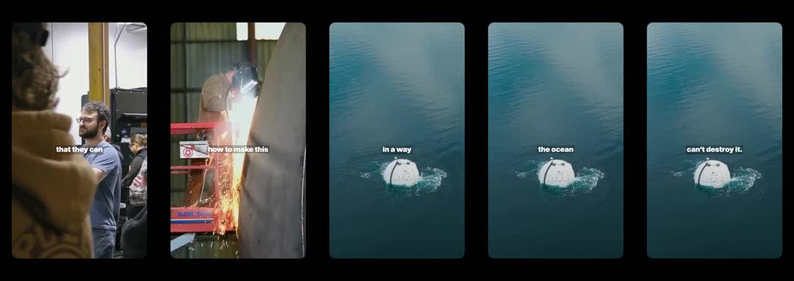

# v16_s52 · full_graphic · 99.0–102.2s (calidad 3)

- **Guion:** that they can figure out how to make this in a way the ocean can't destroy it.
- **Qué se ve:** Tarjeta vertical con 3 clips: ingenieros en un taller (99,03), soldador con chispas (99,77), boya cenital en mar en calma (100,53). Subtítulos «that they can», «figure out», «how to make this», «in a way», «the ocean», «can't destroy it.».
- **Diseño:** Pantalla completa NEGRA con el material dentro de una tarjeta vertical de esquinas redondeadas (~24 px de radio): x≈54–666 px (85 % del ancho), y≈103–1176 px (84 % del alto). Subtítulo: sans bold blanca (tipo Inter/Helvetica Now Bold) ~30 px de alto de fuente sobre 720 px de ancho, 1–3 palabras, centrado en x, sombra negra suave. Subtítulo en y≈680 px (53 %), sobre la tarjeta, con sombra.
- **Efectos:** Fondo negro puro alrededor de la tarjeta; rótulos «NO …» en sans extendida rojo oscuro (~#B01E2E) con sombra/duplicado desplazado.
- **Animación:** La tarjeta entra por corte; dentro, franjas y rótulos aparecen de arriba abajo; sale por corte seco.
- **Por qué aquí:** Esfuerzo humano → gente trabajando.
