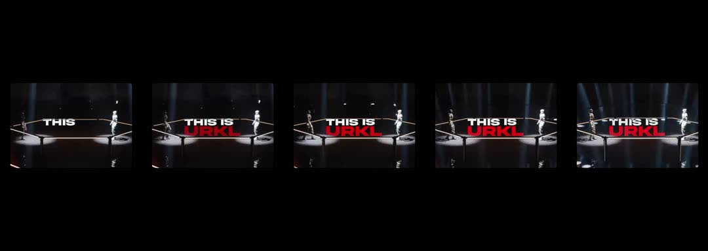

# v18_s02 · full_graphic · 4.3–5.7s (calidad 4)

- **Guion:** This is URKL.
- **Qué se ve:** Pantalla negra con una tarjeta apaisada centrada (≈70 % del ancho, y≈45–55 %): ring con dos robots frente a frente bajo focos y el rótulo «THIS IS / URKL» (blanco + rojo). Sin él y sin subtítulo.
- **Diseño:** Fondo negro puro; tarjeta apaisada de esquinas redondeadas centrada (≈500×170 px, ocupa solo ~13 % del alto); rótulo en sans extendida ultra-black mayúsculas, «THIS IS» blanco y «URKL» rojo ≈#D91E2A, centrado dentro de la tarjeta.
- **Efectos:** Negro puro alrededor de la tarjeta; sin grano.
- **Animación:** Corte seco de entrada (4.34) y salida (5.71); el rótulo se construye por palabra por pop seco (THIS → THIS IS → + URKL) sincronizado a la voz; el clip de dentro se mueve (focos).
- **Por qué aquí:** Presentación del nombre («This is URKL») como tarjeta de título: pausa de 1.4 s que funciona como rótulo de capítulo tras el gancho.
