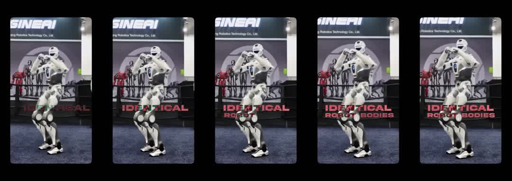

# v18_s12 · full_graphic · 23.5–25.2s (calidad 5)

- **Guion:** robot bodies. So
- **Qué se ve:** Fondo negro con tarjeta vertical: robot blanco bailando en un stand «SINEAI… Robotics Technology Co., Ltd.»; rótulo rojo «IDENTICAL / ROBOT BODIES» que aparece por partes. Sin su cara ni subtítulo.
- **Diseño:** Fondo negro; tarjeta vertical redondeada más estrecha que la de pip (≈62 % del ancho × 80 % del alto); rótulo rojo ≈#D91E2A en sans extendida ultra-black mayúsculas a media altura de la tarjeta, 2 líneas, con el robot recortado por delante.
- **Efectos:** Negro puro alrededor de la tarjeta; sin grano.
- **Animación:** Corte seco de entrada y salida; rótulo con revelado por letra/palabra en ≈1 s (23.5–24.5) sincronizado a «identical robot bodies».
- **Por qué aquí:** La idea clave del video («identical robot bodies») se escribe en pantalla como rótulo, sin cara: es EL dato que hay que retener.
