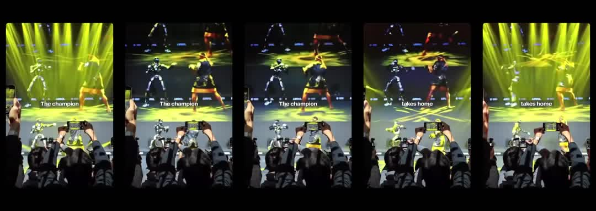

# v18_s17 · full_graphic · 36.0–37.0s (calidad 3)

- **Guion:** The champion takes home a
- **Qué se ve:** Fondo negro con tarjeta: escenario con rayos láser verde-amarillos y público grabando con móviles. Subtítulos dentro de la tarjeta «The champion / takes home». Sin su cara.
- **Diseño:** Fondo negro; tarjeta vertical redondeada a casi todo el ancho, sin círculo de cara; subtítulo blanco pequeño SIN bajar a y≈54 %: aquí queda dentro de la tarjeta en y≈49 %.
- **Efectos:** Negro puro alrededor de la tarjeta; sin grano.
- **Animación:** Corte seco de entrada y salida; el texto del gráfico aparece por palabra / el gráfico trae animación propia.
- **Por qué aquí:** «The champion» → escenario de gala: sube la épica antes de mostrar el premio.
