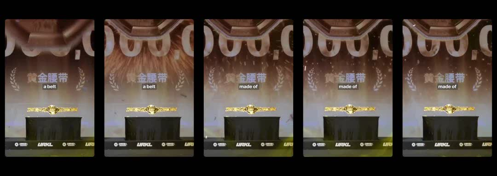

# v18_s18 · full_graphic · 37.0–38.0s (calidad 3)

- **Guion:** belt made of 10
- **Qué se ve:** Tarjeta: cinturón dorado sobre una mesa negra, pantalla de fondo con caracteres «黄金腰带» y laureles. Subtítulos «a belt / made of».
- **Diseño:** Pantalla completa sin él: fondo negro con tarjeta de esquinas redondeadas (gráfico o clip) y texto del propio gráfico; subtítulo pequeño con cajita gris cuando lo hay.
- **Efectos:** Negro puro alrededor de la tarjeta; sin grano.
- **Animación:** Corte seco de entrada y salida; el texto del gráfico aparece por palabra / el gráfico trae animación propia.
- **Por qué aquí:** «a belt» → el objeto exacto.
