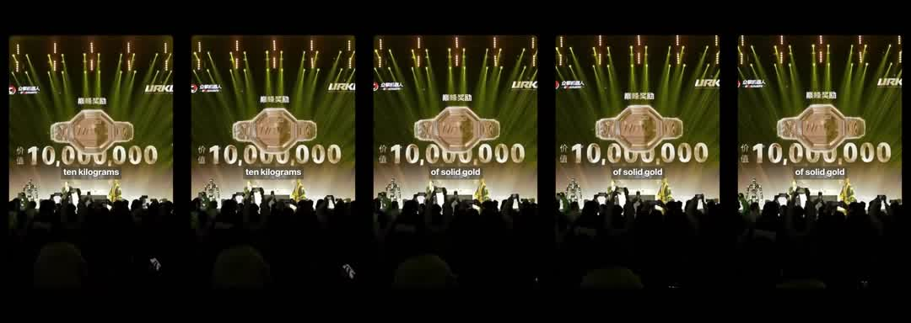

# v18_s19 · full_graphic · 38.0–39.9s (calidad 3)

- **Guion:** kilograms of solid gold, worth
- **Qué se ve:** Tarjeta: escenario con láseres verdes y una pantalla con el cinturón y la cifra «10,000,000»; público a oscuras. Subtítulos «ten kilograms / of solid gold».
- **Diseño:** Pantalla completa sin él: fondo negro con tarjeta de esquinas redondeadas (gráfico o clip) y texto del propio gráfico; subtítulo pequeño con cajita gris cuando lo hay.
- **Efectos:** Negro puro alrededor de la tarjeta; sin grano.
- **Animación:** Corte seco de entrada y salida; el texto del gráfico aparece por palabra / el gráfico trae animación propia.
- **Por qué aquí:** Cifra en la propia imagen del evento refuerza «solid gold».
