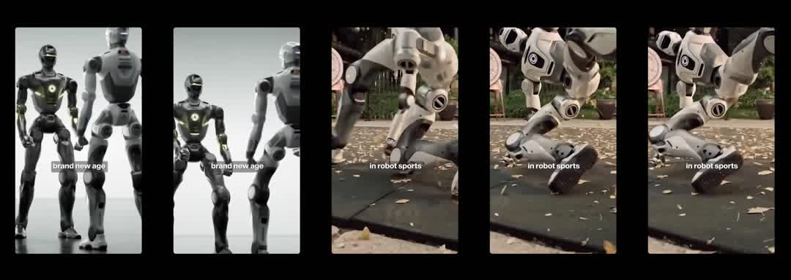

# v18_s25 · full_graphic · 53.3–55.7s (calidad 3)

- **Guion:** new age in robot sports.
- **Qué se ve:** Fondo negro con tarjeta vertical sin su cara: dos robots (negro y gris) sobre fondo blanco de estudio; a los 54.25 cambia a un robot levantándose de un salto en una plaza. Subtítulos con cajita «brand new age / in robot sports».
- **Diseño:** Pantalla completa sin él: fondo negro con tarjeta de esquinas redondeadas (gráfico o clip) y texto del propio gráfico; subtítulo pequeño con cajita gris cuando lo hay.
- **Efectos:** Negro puro alrededor de la tarjeta; sin grano.
- **Animación:** Corte seco de entrada y salida; el texto del gráfico aparece por palabra / el gráfico trae animación propia.
- **Por qué aquí:** «brand new age in robot sports» → robots atléticos fuera del ring: amplía a «deporte».
