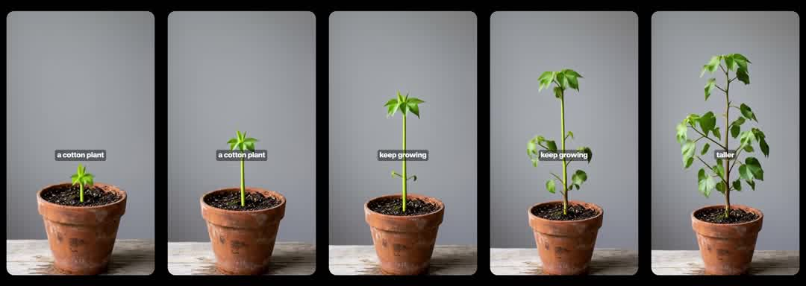

# v20_s20 · full_graphic · 35.9–38.2s (calidad 5)

- **Guion:** a cotton plant would just keep growing taller and
- **Qué se ve:** Tarjeta vertical casi a pantalla completa sin su cara: maceta de barro sobre fondo gris con una planta que crece en time-lapse desde un brote hasta un tallo alto. Subtítulos con cajita «a cotton plant / will just / keep growing / taller».
- **Diseño:** Fondo negro con tarjeta vertical redondeada que ocupa ≈92 % del ancho × 92 % del alto (márgenes ~10 px arriba, ~30 px lados); sin círculo de cara; subtítulo blanco pequeño con cajita gris en y≈54 %.
- **Efectos:** Negro puro alrededor de la tarjeta; sin grano.
- **Animación:** Corte seco de entrada y salida; el texto del gráfico aparece por palabra / el gráfico trae animación propia.
- **Por qué aquí:** «keep growing taller» → la planta creciendo literalmente: explicación visual de biología en 2 s.
