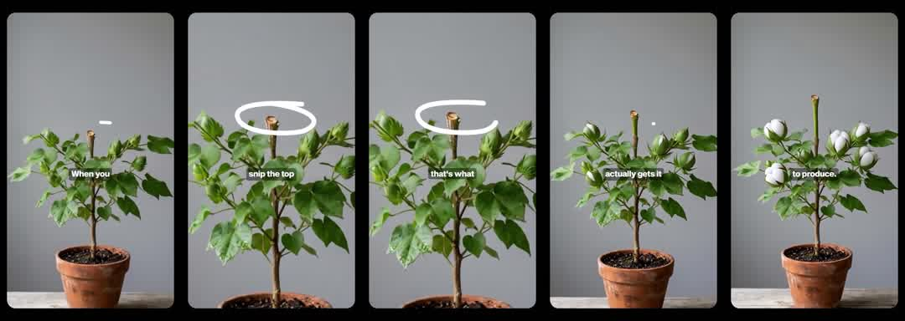

# v20_s22 · full_graphic · 39.2–42.5s (calidad 5)

- **Guion:** When you snip the top off the plant, that's what actually gets it to produce.
- **Qué se ve:** Misma tarjeta: la planta con la punta cortada; un trazo blanco a mano dibuja un óvalo alrededor del corte, desaparece y brotan cápsulas blancas de algodón. Subtítulos «When you / snip the top / off the plant, / that's what / actually gets it / to produce.»
- **Diseño:** Fondo negro con tarjeta vertical (≈92 % ancho × 92 % alto), sin su cara; anotación a mano alzada: trazo blanco irregular de ≈6 px que rodea el corte; subtítulo con cajita en y≈54 %.
- **Efectos:** Negro puro alrededor de la tarjeta; sin grano.
- **Animación:** Corte seco de entrada/salida. El óvalo se DIBUJA progresivamente (write-on de línea, ≈11 fotogramas, 39.41–39.87), se mantiene ≈1 s y se borra del mismo modo (≈41.0).
- **Por qué aquí:** «snip the top» → círculo dibujado a mano sobre el punto exacto + resultado (algodón): señalar con trazo en vez de con texto.
