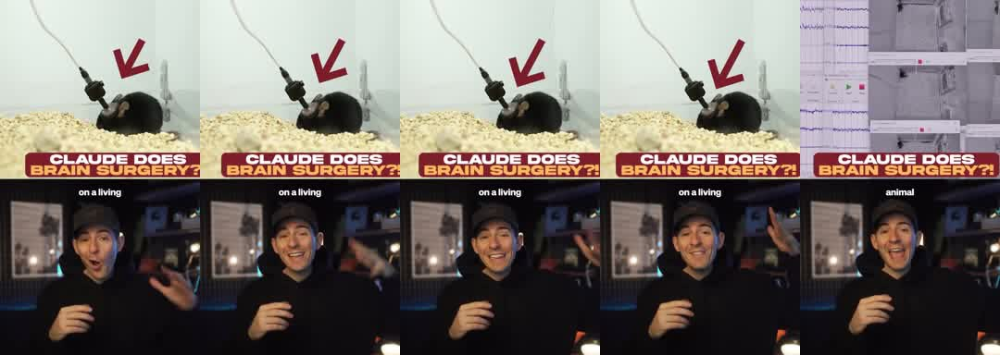

# v01_s03 · hook_banner · 1.8–2.4s (calidad 5)

- **Guion:** a living animal
- **Qué se ve:** Arriba: ratón negro sobre viruta con cable en la cabeza y una FLECHA roja oscura dibujada apuntándole. Franja completa. Subtítulo 'on a living'.
- **Diseño:** Pantalla dividida 50/50 (costura en y≈640 px de 1280). Franja roja oscura (#8B1A1E aprox.) con esquinas redondeadas, de x≈33 a 695 px (92 % del ancho) y de y≈552 a 636 px (alto ≈84 px, 6.5 %), pegada justo ENCIMA de la costura. Dos líneas en sans extendida ultra-bold MAYÚSCULAS: línea 1 blanca 'CLAUDE DOES', línea 2 amarillo-naranja (#F5B942 aprox.) 'BRAIN SURGERY?!'. Subtítulo blanco, sans geométrica bold en minúsculas/caja normal (tipo Gilroy/Satoshi; fuente exacta desconocida), 1–3 palabras, centrado en x=50 %, centro en y≈54 % (≈692 px de 1280), altura de minúscula+ascendente ≈22 px (≈1.7 % del alto), sombra suave oscura.
- **Efectos:** Sin texturas. A-roll con fondo oscuro, luces prácticas desenfocadas (bokeh) y borde azul/cian abajo a la izquierda. La evidencia de arriba va sin grado visible.
- **Animación:** La franja entra deslizándose desde la derecha (a 0.0 s solo asoma por el borde derecho, a ~1.5–2.0 s está centrada y completa); después queda fija hasta 4.05 s. La mitad superior cambia por corte seco cada 0.7–0.9 s. Subtítulo: sustitución seca por bloque, sin animación visible.
- **Por qué aquí:** Muestra el 'animal vivo' justo al decirlo; la flecha dirige el ojo.
