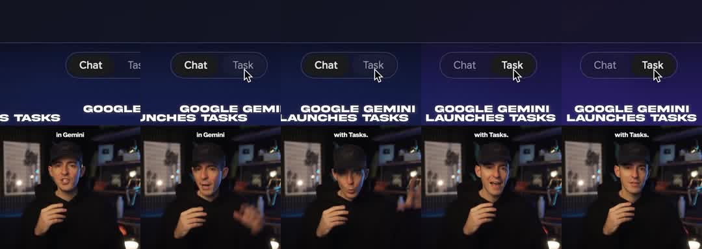

# v02_s02 · hook_banner · 3.1–4.5s (calidad 5)

- **Guion:** Gemini with tasks.
- **Qué se ve:** Arriba: conmutador 'Chat | Task' ampliado; el cursor va a 'Task' y lo activa. Titular blanco 'GOOGLE GEMINI / LAUNCHES TASKS' entrando por la derecha. Subtítulo 'in Gemini' / 'with Tasks.'.
- **Diseño:** Pantalla dividida 50/50 (costura en y≈50 %). Titular SIN caja: dos líneas blancas en sans extendida ultra-bold MAYÚSCULAS 'GOOGLE GEMINI / LAUNCHES TASKS', alineadas a la derecha, altura de línea ≈3 % del alto, apoyadas justo encima de la costura (y≈42–49 %) sobre el fondo azul oscuro de la propia captura. Subtítulo blanco, sans geométrica bold (fuente exacta desconocida), 1–3 palabras, centrado en x=50 %, y≈54 % (justo bajo la costura), altura ≈22 px sobre 1280, sombra suave.
- **Efectos:** Sin texturas; el titular no lleva franja ni sombra visible, se lee por contraste con el azul oscuro.
- **Animación:** El titular entra deslizándose desde la derecha a partir de 3.08 s (a 3.08 solo se ven las primeras letras, a ~3.9 s está completo) y desaparece por corte a 4.55 s. Arriba, el cursor se mueve y hace clic en 'Task'.
- **Por qué aquí:** El titular llega tarde (3.1 s) y coincide con la palabra 'Tasks': nombra la noticia cuando ya viste la función.
