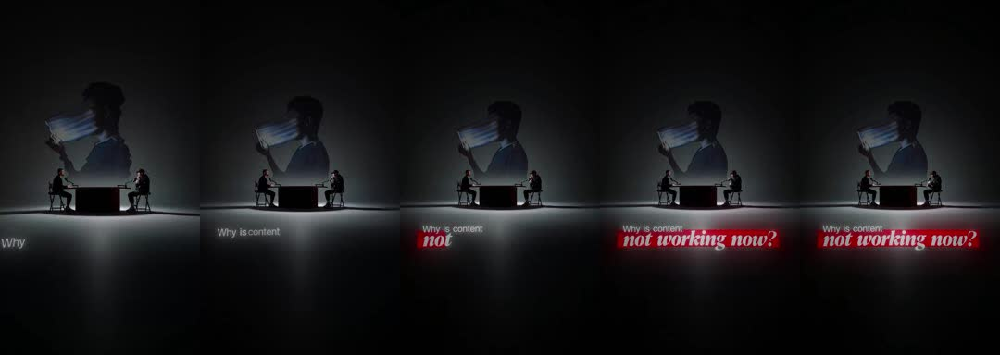

# v03_s01 · hook_banner · 0.0–1.8s (calidad 5)

- **Guion:** Why is content not working now?
- **Qué se ve:** Destello amarillo-rojo de 2 fotogramas; luego plano general de dos siluetas en una mesa a contraluz con una imagen fantasma azulada encima. Título 'Why is content' (gris pequeño) + 'not working now?' (serif itálica blanca sobre barra roja).
- **Diseño:** Plano general del set: dos siluetas sentadas a una mesa, a contraluz sobre una franja de luz blanca horizontal en y≈52–56 %; el resto negro. Título en dos niveles alineado a la izquierda en y≈63–68 %: línea 1 'Why is content' en sans fina gris claro pequeña; línea 2 'not working now?' en serif itálica bold blanca (≈5 % del alto) sobre una barra roja (#C8102E aprox.) con glow rojo, de x≈8 % a 90 %.
- **Efectos:** Glow rojo alrededor de la barra; halo de luz blanca tras las siluetas; viñeta negra fuerte; imagen fantasma azulada semitransparente (persona con una tablet/pantalla) flotando sobre las siluetas.
- **Animación:** Empieza con 2 fotogramas de destello amarillo/naranja/rojo a pantalla completa (0.00–0.08). Las palabras aparecen de izquierda a derecha en gris y pasan a blanco (write-on por palabra); la barra roja crece con el texto de 'not working' a 'not working now?' (0.9–1.5 s).
- **Por qué aquí:** Gancho en forma de pregunta escrita; el plano general oscuro deja todo el peso al texto rojo.
